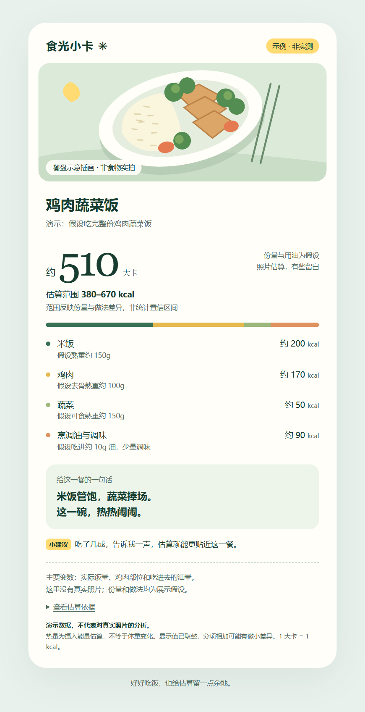

# 食光小卡 · Food Photo Card

**拍张食物照片，让 AI 帮你估热量、记饮食，再生成一张好看的小卡片。**

看了邵艾伦的薄肌相关分享和与孙宇晨的对谈后，我想把日常饮食记录做得轻松一些，让想了解自己饮食的人更容易开始，于是动手做了「食光小卡」。

第一次使用时建立基础档案，之后正常情况下只需要发照片。AI 会识别可见食物、查找营养参照、推测份量，更新当天已记录的摄入和剩余参照，再给一句轻松的点评与下一餐搭配建议。



*上图使用虚构餐食数据，仅演示卡片外观。也可下载 [HTML 示例](examples/card-demo.html)，用浏览器离线打开。*

## 能做什么

- **发图即记**：首次建档后，不例行要求用户解释菜名、克数、做法或吃了几成。
- **面向中餐估算**：将粉面饭、炒菜、烤串、烧饼配汤等拆成食材与做法情景；无法确定的肉种、配料保持中性名称。
- **营养数据可追溯**：读取图片里可见的营养标签，使用已核对的小型参照表，或自动查询香港食物安全中心的公开资料。近似参照与经验假设分开标注。
- **每日累计**：显示本餐估算、当天已记录热量、每日参考和剩余参照。支持份量修正、撤销、补记往日和跨天分别累计。
- **避免重复记账**：相同照片进行哈希检查；同餐补拍、多视角和共享餐盘结合上下文判断。
- **漂亮的小卡片**：生成可离线打开的中文 HTML，附食物拆分、情景范围、来源和友好的饮食建议。

## 这是什么

这是一个供支持图片理解的 AI 助手使用的 **Skill**，不是独立的拍照 App，也没有单独训练新的食物识别模型。图片理解由宿主助手完成，配套 Python 脚本负责查资料、计算、记录和排版。

核心 Skill 在 [`skills/food-photo-card`](skills/food-photo-card)。Python 脚本仅使用标准库，支持 Python 3.10+；在线查询需要网络，计算、日志和 HTML 渲染可以离线运行。

## 安装与使用

在 Codex 中可以直接提出：

> 请从 https://github.com/js110/skill 安装 skills/food-photo-card 这个 Skill。

也可以手动将完整的 `skills/food-photo-card` 文件夹复制到自己的 Codex skills 目录（默认 `~/.codex/skills/food-photo-card`，配置了 `CODEX_HOME` 时使用其 `skills` 子目录）。

使用时上传食物照片并输入：

```text
用 $food-photo-card 开始我的饮食记录。
```

首次会了解年龄、身高、体重、热量公式所用性别、活动量和目标，必要时了解特殊饮食情况。可跳过不愿提供的信息；资料不足时先记录食物，不编造个性热量限额。完成建档后只需继续发图。

修改或撤销是可选操作，例如“上一餐只吃了一半”“撤销刚才那张”。不需要每次都写说明。每次独立聊天的状态文件路径会告知用户，跨聊天续记需指定相同文件。

## 估算依据与准确性

食物热量按“可食份量 × 对应热量密度”计算。每天的维持能量参考采用 Mifflin–St Jeor 静息能量估算，再结合活动情景。活动量分档是工具的起始约定，不代表已经针对使用者校准。

- [Mifflin–St Jeor 原研究](https://pubmed.ncbi.nlm.nih.gov/2305711/?dopt=Abstract)
- [中国营养与健康所食物成分平台说明](https://www.chinanutri.cn/yyzyxxpt/sjzx/swcfsjk/201911/t20191128_207183.html)
- [香港食物安全中心营养资料](https://www.cfs.gov.hk/sc_chi/nutrient/)

中国食物成分查询站的可访问性会变化；当前未接入其完整数据库。附带参照表只有少量已核对条目，遇到新食物可继续在线查找。第三方营养数据保留原始来源和使用限制，公开本项目不等于获得数据库商业使用授权。

**照片无法直接测出重量、藏在食物里的油或个人实际吃掉多少。** 默认按图片可见个人份量暂计，细节不清时保留不同做法与份量的情景范围；明显共享餐食另行处理。范围不是统计置信区间，也不保证覆盖真实值。

本项目尚未完成基于独立称重中餐样本的准确率验证，不承诺“准确率 95%”等数字。已通过的计算和记录测试不能替代食品营养准确性验证。剩余参照不是必须吃满或必须停食的命令，建议不会要求跳餐或运动补偿。未成年人、孕哺期及需特殊照护者采用记录模式，不自动设置饮食限额。

## 隐私与保存

个人档案和餐次保存在当前聊天专用的本地状态文件，不写入共享 Skill 目录。HTML 中的照片为内嵌图片；分享卡片时应留意卡片中包含的内容。在线食物查询脚本只发送查询词和食物代码，不上传照片或个人档案；宿主 AI 平台如何处理图片取决于其自身设置。

仓库中不包含作者的个人档案、真实饮食日志或私人食物照片。

## 文件结构

```text
skills/food-photo-card/
  SKILL.md                      助手执行规则
  agents/openai.yaml            展示信息与默认提示
  assets/card.html              卡片模板
  references/                   图像分析、营养参照和每日记录说明
  scripts/
    cfs_lookup.py               在线查询营养条目
    estimate_meal.py            份量与候选密度计算
    daily_log.py                本地每日记录
    render_card.py              HTML 卡片生成
examples/                       虚构示例数据与 HTML
tests/                          计算和记录回归测试
docs/分享文案.md                 抖音口播与朋友圈文案
```

本地生成示例与运行测试：

```bash
python skills/food-photo-card/scripts/render_card.py examples/demo-meal.json --output examples/card-demo.html
python -m unittest discover -s tests -v
```

分享介绍可见 [`docs/分享文案.md`](docs/分享文案.md)。
